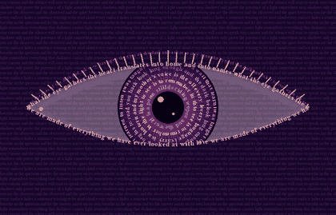

<div align="center">

# Poetry Eye

**An eye made entirely of poetry.**
Every iris ring, every eyelid and every row of background texture is verse, drawn in code.




*"what the eye gathers, the heart translates into home and into names"*

</div>

---

## What it does

- **Iris rings of text** that rotate at different speeds
- **Eyelids written in verse** that open and blink
- **A pupil that pulses** and a gaze that slowly drifts
- **Lashes, a tear duct and a soft lid shadow** for a more lifelike eye
- **Rows of poetry in the background**, in a sunset palette of plum, pink and gold

## Run it

You need Python 3 and one package:

```
pip install pygame-ce
python eye.py
```

Press `Esc` to close the window.

> If `pip install pygame` fails on a newer version of Python, use `pygame-ce` as shown above. It is a drop-in replacement.

## Make it yours

The poem and the colors are plain variables at the top of `eye.py`.

```python
ring_lines = [
    "i was taught that a window is a wall that learned to listen ",
    "look long enough and the dark begins to read you back ",
    # add your own lines here
]
```

Swap in your own words and your own palette, and the eye rewrites itself. Keep a space at the end of each line so the rings loop cleanly.

## Why I made this

I wanted to see what a poem looks like when it opens its eyes. Now my poem is looking back at me.

## About

Built by **the authoress**, a young woman in tech and a poet. I make things with code, words and color.

**TikTok:** [@_theauthoress_](https://www.tiktok.com/@_theauthoress_)

